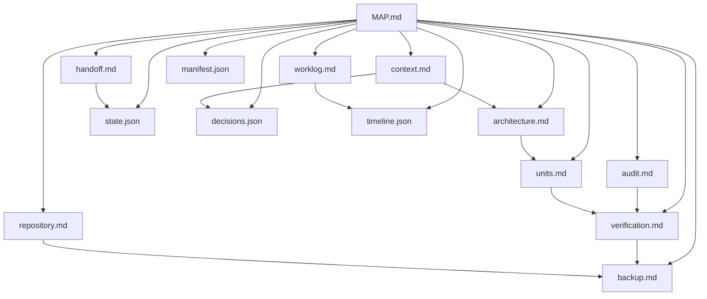

# .xcontext Map

Durable project memory for the **BNBC 2020 Foundation Designer**. Read this file
first in a new session. It records what the project is, how it is built, what was
changed, how it is verified, where it is published, and what to do next.

## Reading order

| # | File | What it answers |
|---|---|---|
| 1 | [context.md](context.md) | What is this project, what decisions govern it, and what is the current state? |
| 2 | [architecture.md](architecture.md) | How is the code organized and how does data flow? |
| 3 | [audit.md](audit.md) | Which 17 audit findings were fixed, and what protects each one? |
| 4 | [units.md](units.md) | How do SI and US customary units work at the boundaries? |
| 5 | [verification.md](verification.md) | What tests, exports and smoke checks prove the current state? |
| 6 | [repository.md](repository.md) | Where is the public repository, who owns it, and what is the license? |
| 7 | [backup.md](backup.md) | How is the local zip backup built, excluded and restored? |
| 8 | [worklog.md](worklog.md) | What happened, in chronological order? |
| 9 | [handoff.md](handoff.md) | What should the next session do first? |

## Machine-readable records

- [manifest.json](manifest.json) — file inventory, roles and relationships.
- [state.json](state.json) — current status, test counts, repository, backup and blockers.
- [decisions.json](decisions.json) — accepted design and engineering decisions by ID.
- [timeline.json](timeline.json) — structured event log.

## Relationship map

## Source-of-truth order

1. Code and tests in `bnbc_foundation/` and `tests/`.
2. `.xcontext/state.json` for current machine-readable status.
3. The narrative files in `.xcontext/`.
4. `.opencode/{context,plan,progression,todo,ponyfix}.md` for the detailed
   historical build and audit log.
5. `README.md` for user-facing documentation.

If code and documentation disagree, trust the code and tests, then update the
documentation and `state.json`.
